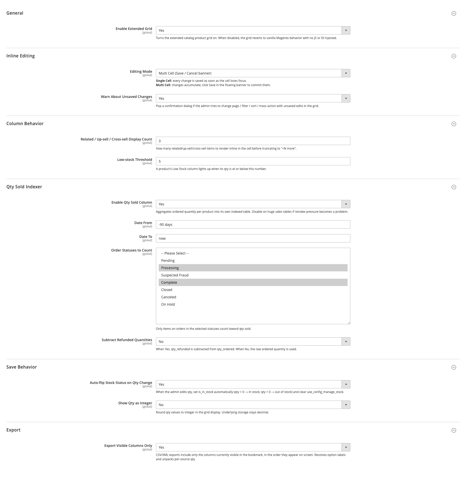
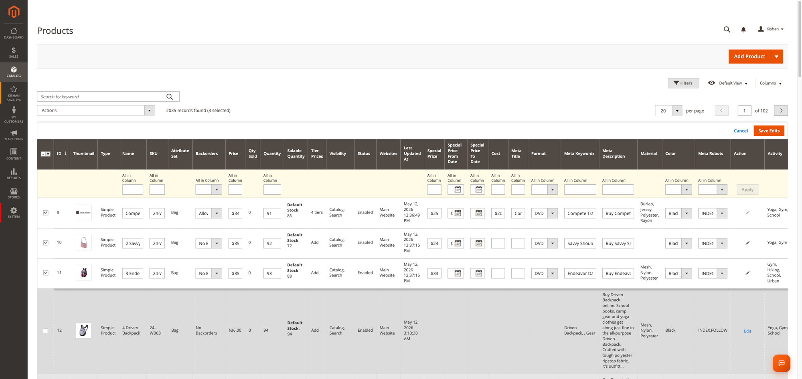
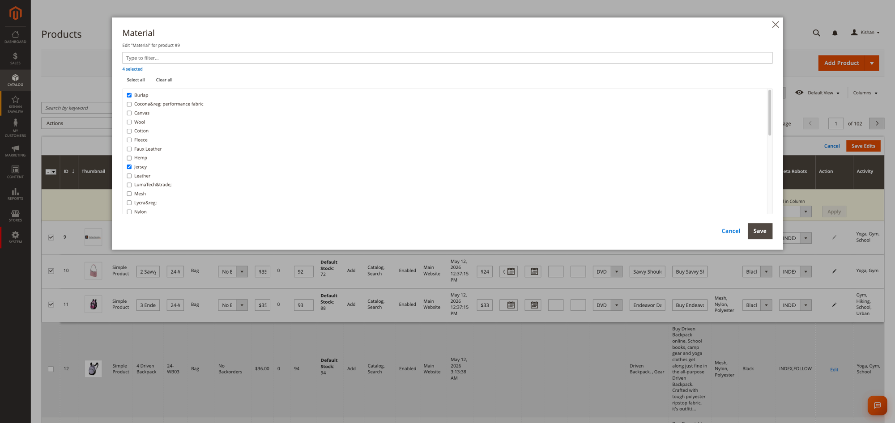
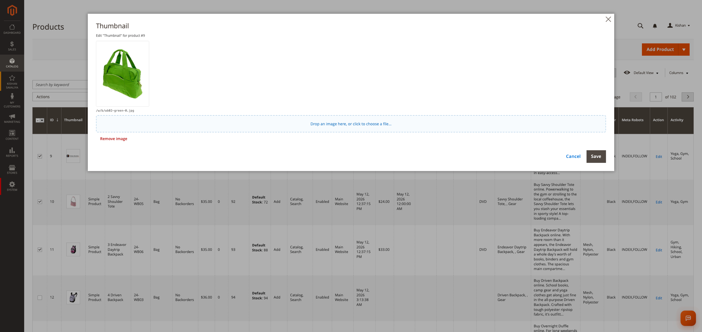
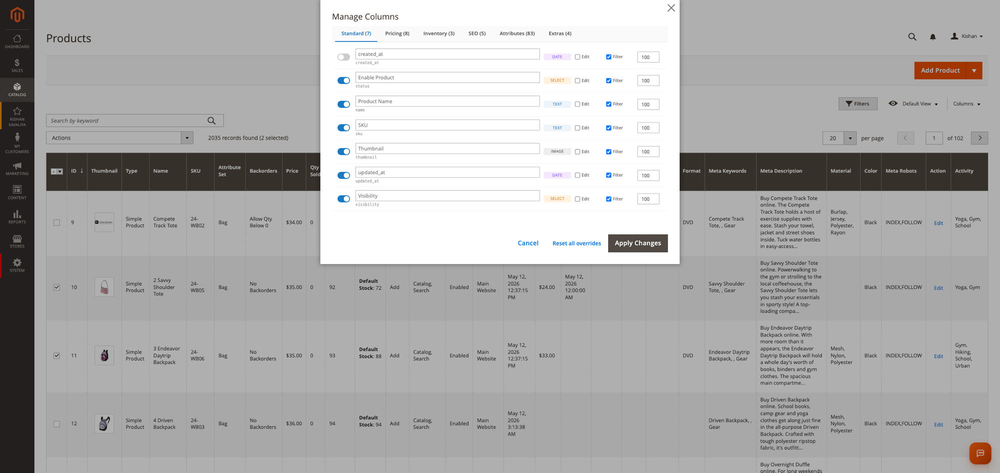
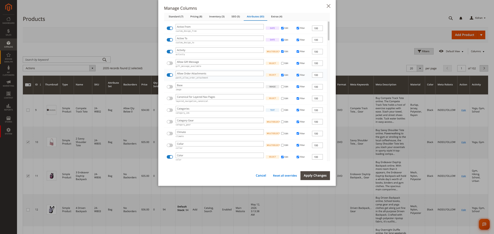

# Magento 2 Advanced Product Grid

Advanced Product Grid extends the standard product grid in the Magento 2 admin (Catalog > Products). It adds inline editing to the grid columns, discovers product attributes flagged "Use in Grid" and turns them into columns with filters and editors, adds computed columns such as image, availability, low stock, qty sold, tier prices and storefront link, provides a tabbed "Manage Columns" panel for showing, renaming and ordering columns, a "Mass Edit Attributes" mass action, and CSV/XML export limited to the visible columns.

It is intended for catalog managers and store administrators who update product data from the product grid instead of opening each product edit form. The module works in the admin area only and does not change the storefront.

Product page: [Magento 2 Advanced Product Grid](https://kishansavaliya.com/magento-2-advanced-product-grid.html)


## Features

- Inline editing on the product grid using Magento's built-in grid editor. "Name", "SKU", "Price" and "Quantity" are editable out of the box; attributes discovered from EAV get a text, select, multiselect, date or image editor depending on their input type.
- Automatic discovery of every product attribute with "Use in Grid" enabled (text, textarea, select, multiselect, date, datetime, weight, price, boolean and media image inputs). Attributes enabled in the column manager or made visible in a saved bookmark are added as columns as well.
- Extra columns: "Image" (with hover View / Edit overlay), "Categories" (full category paths, filterable, including "No Categories"), "Availability", "Backorders", "Low Stock", "Qty Sold", "Tier Prices" and "Frontend Link". "Qty Sold", "Availability", "Backorders" and "Low Stock" can be sorted; "Backorders" and "Availability" follow the inventory configuration for products that use the config value.
- Inline edits send only the cells you changed, so empty select attributes are not filled with their first option and unchanged values are not re-saved. Prices typed or shown with a currency symbol or thousands separator (for example `$1,234.50`) are parsed with the admin locale before validation.
- Popup editors for values that do not fit in a cell: textarea attributes, multiselect attributes (searchable checkbox list with "Select all" / "Clear all"), categories, tier prices (website, customer group, qty, fixed or percent) and product images (drag-and-drop upload, preview, remove).
- "Manage Columns" panel with the tabs Standard, Pricing, Inventory, SEO, Attributes and Extras. Per column: show/hide, custom label, "Edit" and "Filter" toggles and a numeric sort order. Overrides are stored in the database and applied to the admin user's grid bookmark. A "Reset all overrides" button clears them.
- Rename a column by double-clicking its header in the grid.
- "Mass Edit Attributes" mass action: choose any number of attributes grouped as Pricing, Inventory, Visibility, Content, SEO and Other, enter values, and apply them to the selected products.
- Filter handling for discovered attributes: multiselect filters use `finset`, select and boolean filters use `eq`, text and textarea filters use `like`. Filter classes are shipped for categories (including a "No Categories" option), availability, backorders, low stock, qty sold range and thumbnail added / not added; they are registered for the columns `panth_categories`, `panth_availability`, `panth_backorders`, `panth_low_stock`, `panth_qty_sold` and `panth_thumbnail`.
- "Qty Sold" column backed by its own indexer (`panth_product_grid_qty_sold`) that aggregates `sales_order_item` quantities for a configurable date window and set of order statuses.
- Unsaved-changes guard: paging, page size, search, filters, toolbar actions, bookmarks, mass actions and export ask for confirmation while the grid has unsaved inline edits.
- "Export" button (CSV and Excel XML) on the product grid toolbar. Exports are limited to the columns visible in the current bookmark, in their on-screen order, with select and multiselect values exported as option labels. Columns can be excluded from export per column (`in_export` flag).
- Fixes bundled with the grid: correct labels for select values that contain commas (for example `INDEX,FOLLOW`), store-scope aware sorting for "Country of Manufacture", and an explicit `maximumStocksToShow` value for the MSI "Salable Quantity" column.
- Horizontal scrolling for wide grids.

## Compatibility

| Platform | Versions |
|---|---|
| Magento Open Source | 2.4.4 to 2.4.8 |
| Adobe Commerce | 2.4.4 to 2.4.8 |
| PHP | 8.1, 8.2, 8.3, 8.4 |

Composer constraints on Magento packages: `magento/framework` ^103.0, `magento/module-backend` ^102.0, `magento/module-catalog` ^104.0, `magento/module-catalog-inventory` ^100.4, `magento/module-eav` ^102.1, `magento/module-store` ^101.1, `magento/module-ui` ^101.2.

## Requirements

- Magento Open Source or Adobe Commerce 2.4.4 to 2.4.8
- PHP 8.1, 8.2, 8.3 or 8.4 (`php: ~8.1.0||~8.2.0||~8.3.0||~8.4.0`)
- `mage2kishan/module-core` ^1.0 (module `Panth_Core`; provides the "Panth Extensions" configuration tab and admin menu)
- Suggested: `magento/module-inventory-api` (MSI) and `magento/module-configurable-product`; both are optional and the module loads after `Magento_ConfigurableProduct` when it is present

## Installation

```bash
composer require mage2kishan/module-advanced-product-grid
bin/magento module:enable Panth_Core Panth_AdvancedProductGrid
bin/magento setup:upgrade
bin/magento setup:di:compile
bin/magento setup:static-content:deploy -f
bin/magento cache:flush
```

`setup:di:compile` is only required in production mode. `setup:static-content:deploy -f` is needed because the module ships JavaScript, templates and LESS under `view/adminhtml/web`.

The "Qty Sold" column is empty until the indexer has run once:

```bash
bin/magento indexer:reindex panth_product_grid_qty_sold
```

Check that the module is enabled:

```bash
bin/magento module:status Panth_AdvancedProductGrid
```

## Configuration

Admin path: Stores > Configuration > Panth Extensions > Product Grid Extended. All settings are global (default scope only).



### General

| Setting | Default | What it does |
|---|---|---|
| Enable Extended Grid | Yes | Master switch. When No, Catalog > Products shows the standard Magento product grid: no extra columns or filters, no inline editing, no "Mass Edit Attributes" action, no "Export" button and the native "Columns" dropdown instead of the "Manage Columns" panel. Saved grid views keep working; filters and sorting saved on the extended columns are ignored while the switch is off. Changes apply after the next page load (flush the config cache if it is enabled). |

### Inline Editing

| Setting | Default | What it does |
|---|---|---|
| Editing Mode | Multi Cell (Save / Cancel banner) | Options are "Single Cell (save on blur)" and "Multi Cell (Save / Cancel banner)". Shown only when "Enable Extended Grid" is Yes. |
| Warn About Unsaved Changes | Yes | Declared as the switch for the confirmation dialog shown when the admin changes page, filter, sort or runs a mass action with unsaved edits. Shown only when "Editing Mode" is Multi Cell. |

Note: "Editing Mode" and "Warn About Unsaved Changes" are not read in this version. The grid editor always runs in Magento's standard mode (edits are collected and sent when the editor's Save button is clicked) and the unsaved-changes confirmation is always active. The module's RequireJS mixins stay loaded when the switch is off; they do nothing without the extended grid.

### Column Behavior

| Setting | Default | What it does |
|---|---|---|
| Related / Up-sell / Cross-sell Display Count | 3 | Number of linked products to render in a cell before truncating. The value is passed to each grid row as `panth_linked_products_max`. |
| Low-stock Threshold | 5 | A product is flagged in the "Low Stock" column when stock is managed and its qty is at or below this number. |

### Qty Sold Indexer

| Setting | Default | What it does |
|---|---|---|
| Enable Qty Sold Column | Yes | Declared as the switch for the qty-sold aggregation. |
| Date From | -90 days | Start of the aggregation window. Accepts a `YYYY-MM-DD` date or a relative `strtotime` expression. |
| Date To | now | End of the aggregation window, same formats as "Date From". |
| Order Statuses to Count | complete, processing | Only order items on orders in these statuses are counted. Changing the value invalidates the indexer. |
| Subtract Refunded Quantities | No | When Yes, `qty_refunded` is subtracted from `qty_ordered` per item. Changing the value invalidates the indexer. |

### Save Behavior

| Setting | Default | What it does |
|---|---|---|
| Auto-flip Stock Status on Qty Change | Yes | When qty is edited in the grid, `is_in_stock` is set to 1 for qty > 0 and 0 for qty = 0, `manage_stock` is set to 1 and `use_config_manage_stock` to 0. |
| Show Qty as Integer | No | Rounds qty values to an integer for display in the grid. Stored values stay decimal. |

### Export

| Setting | Default | What it does |
|---|---|---|
| Export Visible Columns Only | Yes | CSV and XML exports from the product grid contain only the columns visible in the current bookmark, in on-screen order, with option labels resolved. When No, Magento's standard export is used. |

Configuration paths: `panth_product_grid/general/enabled`, `panth_product_grid/editing/mode`, `panth_product_grid/editing/confirm_navigation`, `panth_product_grid/columns/linked_products_qty`, `panth_product_grid/columns/low_stock_threshold`, `panth_product_grid/qty_sold/enabled`, `panth_product_grid/qty_sold/date_from`, `panth_product_grid/qty_sold/date_to`, `panth_product_grid/qty_sold/statuses`, `panth_product_grid/qty_sold/include_refunded`, `panth_product_grid/modification/qty_to_stock`, `panth_product_grid/modification/show_qty_integer`, `panth_product_grid/export/visible_columns_only`.

With the default values the extended grid is active, qty edits update the stock status, the qty-sold window is the last 90 days of complete and processing orders, and exports contain only visible columns.

## Usage

### Opening the grid

Go to Catalog > Products, or use the admin menu entry Panth Extensions > Product Grid Extended > Open Extended Grid, which opens the same page. The Configuration menu entry under the same group opens the configuration section.

### Inline editing

Click a cell in an editable column to open Magento's grid editor for that row. Edits are collected in the editor and saved together with its Save button; the request is posted to `panth_product_grid/index/inlineEdit`. Each attribute is applied through a save strategy and the product is then saved with the product repository:

- `qty`: sets the stock quantity and, when "Auto-flip Stock Status on Qty Change" is Yes, the stock status.
- `panth_availability`: sets `is_in_stock` and `manage_stock` ("In Stock", "Out of Stock", "Manage Stock Disabled").
- `panth_backorders`: sets `backorders` ("No Backorders", "Allow Qty Below 0", "Allow Qty Below 0 and Notify Customer").
- `category_ids`: assigns the product to the given categories, or removes it from all categories when the value is empty.
- `tier_price`: replaces the product's tier prices with the submitted rows.
- `weight`: sets the weight and the "product has weight" flag.
- `visibility`: sets visibility; values outside the four Magento options fall back to "Catalog, Search".
- `url_key`: sets the URL key.
- `image`, `small_image`, `thumbnail`, `swatch_image`: assigns an existing or uploaded gallery file to that image role. Paths containing `..` segments, backslashes, control characters or a URL scheme are rejected.
- Any other attribute: the value is written to the product; the sentinels `__use_default__` and `__empty__` clear the value.

Only keys that the grid can show as editable columns are accepted: the virtual keys listed above and product attributes that are visible in the admin and have a text, textarea, price, weight, date, datetime, select, boolean or multiselect input. System keys such as `entity_id`, `type_id`, `attribute_set_id`, `created_at`, `store_id`, `website_ids`, `url_path`, `custom_layout_update_file`, `media_gallery` and `quantity_and_stock_status`, unknown keys and hidden attributes are rejected. Values are checked against the attribute type: prices, weights and quantities must be numbers of zero or more, dates must parse, select, boolean and multiselect values must be existing option values, text values must be scalars (at most 255 characters for varchar attributes), and required attributes cannot be emptied. A rejected change stops the save for that product and the error names the attribute. The `entity_id` value that Magento's grid editor sends with each row is ignored when it matches the row.

Before a save, the module checks that each edited attribute belongs to the product's attribute set and adds it to the set's default group if it is missing, so the value is persisted.

Edits are saved in the store scope given by the `store_id` request parameter; when the parameter is absent the default (global) scope is used. The popup editors load and save values in the store view selected in the grid's "Store View" filter, or in the default scope when no store view is selected.



### Popup editors

Cells in the following columns open a popup instead of the inline editor: `tier_price` / "Tier Prices", `category_ids` / categories, `description`, `short_description`, image roles, and every product attribute whose input type is textarea or multiselect. The popup loads the current value and options from `panth_product_grid/cellEdit/form`, and saves through the same inline-edit endpoint. Image cells show a hover overlay: "View" triggers Magento's standard image preview, "Edit" opens the upload popup (JPG, JPEG, GIF, PNG and WebP; files are stored under the catalog product media directory; each upload must be a valid image).





### Manage Columns

The "Columns" button on the grid toolbar opens the "Manage Columns" popup with the tabs Standard, Pricing, Inventory, SEO, Attributes and Extras. Every grid column is listed, including ID, Type, Attribute Set, Quantity, Salable Quantity, Websites and Action; the label field shows the grid's own column label as placeholder, and the switches show the column's current state in the grid. For each column you can toggle visibility, enter a custom label, toggle "Edit" (inline editable) and "Filter" (filter shown in the toolbar), and set a sort order. "Apply Changes" saves the overrides to `panth_product_grid_column_config`, updates the visibility and positions in the current admin user's product grid bookmark, and reloads the page. "Reset all overrides" deletes every stored override and the admin user's product grid bookmarks.

Columns that are hidden in the panel are still loaded into the data provider when they have an override row or are visible in any bookmark. The `in_export` flag stored per column is honoured by the export but the panel in this version does not expose a toggle for it.

Double-clicking a column header in the grid opens a "Rename Column" prompt that stores a custom label for that column.





### Mass Edit Attributes

Select products, then choose "Mass Edit Attributes" from the Actions dropdown. A slide-in panel lists attributes grouped as Pricing, Inventory, Visibility, Content, SEO and Other (only user-defined or static attributes with text, textarea, price, weight, date, select or multiselect input, plus "Availability", "Backorders" and "Categories"). Tick the attributes to change, enter values, and click "Apply Changes". The values are applied to every selected product through the same save strategies as inline editing; multiselect and category values are entered as comma-separated lists. The same attribute and value checks as inline editing apply. Mass edits are saved in the store view selected in the grid's "Store View" filter; the default scope is used only when the filter is "All Store Views".

### Qty Sold

The "Qty Sold" column reads from the table `panth_product_grid_qty_sold`, which is filled by the indexer "Product Qty Sold" (`panth_product_grid_qty_sold`). A full reindex truncates the table and re-aggregates `sales_order_item.qty_ordered` (minus `qty_refunded` when configured) for orders in the configured statuses and date window. In "Update on Save" mode the affected products are re-aggregated after an order is saved; in "Update by Schedule" mode changes to `sales_order_item` are picked up by the mview subscription, which is bound to the `sales` connection so it also works with a split sales database. New products get a zero row when they are first saved.

### Export

With "Export Visible Columns Only" set to Yes, the CSV and XML export actions on the product grid write only the visible columns in their current order. Select and multiselect values are exported as their option labels. Columns whose `in_export` flag is 0 are skipped. Exports from other admin grids are not changed and use Magento's standard export.

## Developer Notes

- Module name: `Panth_AdvancedProductGrid`
- Composer package: `mage2kishan/module-advanced-product-grid`
- PHP namespace: `Panth\AdvancedProductGrid`
- Admin route: `panth_product_grid` (controllers under `Controller/Adminhtml`: `Index/InlineEdit`, `CellEdit/Form`, `CellEdit/Upload`, `ColumnManager/ListColumns`, `ColumnManager/InlineEdit`, `ColumnManager/MassAction`, `ColumnManager/RenameFromGrid`, `ColumnManager/Reset`, `MassEdit/Form`, `MassEdit/Save`, `Thumbnail/GetModal`, `TierPrice/GetModal`)
- UI component: overlay of `product_listing` (`view/adminhtml/ui_component/product_listing.xml`) with `Ui\Component\Listing\Columns` as the columns class; `Ui\Component\Listing\ColumnFactory` builds columns for discovered attributes; `Ui\Component\Listing\AttributeRepository` selects the attributes.
- Plugins: `Plugin\Catalog\Ui\DataProvider\ProductDataProviderPlugin` (adds attributes to the collection and computed row data), `Plugin\Catalog\Ui\DataProvider\ProductDataProviderFilterPlugin` (rewrites filter conditions per input type), `Plugin\Catalog\Ui\DataProvider\ProductDataProviderSortPlugin` (SQL sorting for the computed stock and qty sold columns, using `Ui\DataProvider\Product\StockExpressions`), `Plugin\Ui\Model\Export\CsvExport` and `XmlExport` (visible-column export), `Plugin\Catalog\Model\Product\Attribute\Source\CountryofmanufactureSortingPlugin`, `Plugin\Mview\SalesConnectionPlugin`.
- Inline-edit extension point: `Model\InlineEdit\StrategyResolver` maps attribute codes to `Model\InlineEdit\Strategy\StrategyInterface` implementations; add a strategy through the `strategies` argument in `etc/di.xml`. `Model\InlineEdit\Processor` runs the strategies and saves the product. After a `url_key` or `visibility` change the processor dispatches the event `panth_product_grid_url_rewrite_refresh` with the product; no observer for it is shipped.
- Column overrides: `Model\ColumnConfigRepository` (table `panth_product_grid_column_config`); `Model\BookmarkVisibilityUpdater` writes visibility and positions into `ui_bookmark`.
- Indexer: `Model\Indexer\QtySold` (`etc/indexer.xml`, `etc/mview.xml`); observers `Observer\OrderSaveAfter` (`sales_order_save_after`) and `Observer\ProductSaveAfter` (`catalog_product_save_after`); `Model\Config\Backend\QtySoldInvalidate` invalidates the indexer when statuses or the refund setting change.
- Mass edit: `Model\MassEdit\AttributeCatalog` builds the attribute list for the mass edit panel.
- JavaScript: RequireJS mixins in `view/adminhtml/requirejs-config.js` on paging, sizes, search, filters, toolbar, bookmarks, massactions, tree-massactions, export, the select column and the grid editor (the editor mixin limits the inline-edit payload to changed cells); `js/model/unsaved-flag.js` holds the dirty state; the column manager, popup editors and rename prompt are bootstrapped from `view/adminhtml/templates/rename-header-init.phtml` (added to `head.additional` of the product grid page only by `view/adminhtml/layout/catalog_product_index.xml`).
- ACL resources (`etc/acl.xml`, under `Panth_Core::panth_extensions`): `Panth_AdvancedProductGrid::product_grid` ("Product Grid Extended"), `Panth_AdvancedProductGrid::inline_edit` ("Inline Edit Products"), `Panth_AdvancedProductGrid::tier_price` ("Edit Tier Prices"), `Panth_AdvancedProductGrid::manage_gallery` ("Edit Product Gallery"), `Panth_AdvancedProductGrid::column_manager` ("Manage Grid Columns", checked by the column manager controllers), `Panth_AdvancedProductGrid::config` ("Configuration"). Every controller of the module also requires `Magento_Catalog::products`. Inline edit and mass edit requests that change tier prices require `Panth_AdvancedProductGrid::tier_price`, and requests that change an image role require `Panth_AdvancedProductGrid::manage_gallery`. POST requests are validated with the admin form key.
- Database tables (`etc/db_schema.xml`): `panth_product_grid_qty_sold` (product_id, qty_sold, indexed_at) and `panth_product_grid_column_config` (config_id, attribute_code, is_visible, is_editable, is_filterable, in_export, is_required, custom_label, sort_order, default_width, marker_color, editor_type_override, updated_at).
- `Model\InlineEdit\ChangeValidator` holds the allow-list and type checks used by `Model\InlineEdit\Processor` for inline edit, popup edit and mass edit.
- Unit tests are included: `Test/Unit/Observer/OrderSaveAfterTest.php` and `Test/Unit/Model/InlineEdit/ChangeValidatorTest.php`.

## Uninstallation

```bash
bin/magento module:disable Panth_AdvancedProductGrid
composer remove mage2kishan/module-advanced-product-grid
bin/magento setup:upgrade
bin/magento setup:di:compile
bin/magento cache:flush
```

Disabling the module leaves the tables `panth_product_grid_qty_sold` and `panth_product_grid_column_config`, the `panth_product_grid/*` rows in `core_config_data`, the indexer state for `panth_product_grid_qty_sold`, product grid bookmark changes in `ui_bookmark` and attribute-set assignments created during inline editing in place. Remove them manually if they are no longer needed.

## Support

- Product page: [Magento 2 Advanced Product Grid](https://kishansavaliya.com/magento-2-advanced-product-grid.html)
- Contact form: [kishansavaliya.com/contact](https://kishansavaliya.com/contact)
- Email: kishansavaliyakb@gmail.com
- Issues: [GitHub issues](https://github.com/mage2sk/module-advanced-product-grid/issues)

## License

Free and open source under the MIT License. See [LICENSE.txt](LICENSE.txt).

## Changelog

See [CHANGELOG.md](CHANGELOG.md).

## Links

- Website: [kishansavaliya.com](https://kishansavaliya.com)
- All extensions: [Magento extensions catalogue](https://kishansavaliya.com/magento-extensions.html)
- GitHub: [mage2sk/module-advanced-product-grid](https://github.com/mage2sk/module-advanced-product-grid)
- Packagist: [mage2kishan/module-advanced-product-grid](https://packagist.org/packages/mage2kishan/module-advanced-product-grid)
